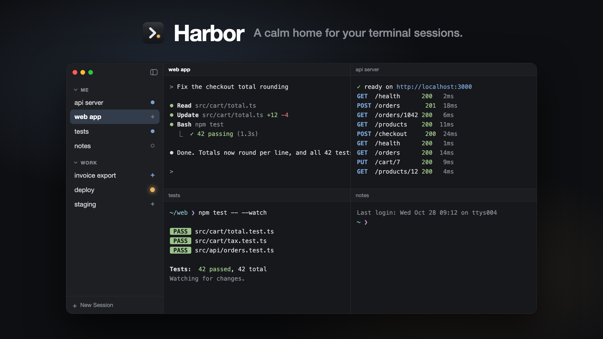

<p align="center">
  <a href="#tour"></a>
</p>

<h1 align="center">Harbor</h1>

<p align="center">
  <b>A calm home for your terminal sessions.</b><br>
  A native macOS app that turns twenty scattered terminal tabs into one window: named sessions in groups,<br>
  shells that keep running when you quit, and a clear signal the moment Claude Code needs you.
</p>

<p align="center">
  <a href="#tour">▶ See the 30-second tour</a>
</p>

---

## Tour

<p align="center">
  
</p>

## Why

You have a dev server in one tab, tests in another, three Claude Code sessions somewhere, an SSH into staging… and one of them has been waiting for your answer for ten minutes. Harbor gives every session a name and a place, and tells you which one needs you.

## Features

- **Named sessions in groups.** Organise sessions into groups like *Me* and *Work*. Rename, reorder and drag them between groups.
- **Real terminals.** Each session is your login shell, started the way Terminal starts it, so your aliases and tools just work. Copy and paste, find, font sizes, mouse selection and 10,000 lines of scrollback all work too.
- **Sessions outlive the app.** A small background host keeps your shells alive. Quit Harbor, reopen it, and everything is still running, with its output intact.
- **Knows what Claude is doing.** The sidebar shows each session as idle, running, Claude working, or *needs you*. When Claude finishes or waits for permission, Harbor marks the session, badges the Dock icon and sends a notification. <kbd>⌘J</kbd> jumps to the next session that needs you.
- **Panes.** Split right or down, zoom one pane, or show a whole group as a grid.
- **Archive.** Archive sessions by hand, or automatically once they've been quiet for a few days. Archived sessions keep their output and come back in one click.
- **Find anything.** <kbd>⌘F</kbd> finds any session, live or archived, by its name or its group's name.
- **Edit what you're typing with the mouse.** Select part of the command you're typing, then delete it, cut it or type over it, as in a text field. This works at the shell prompt, in Claude's input box and in most REPLs.
- **Quiet by design.** Dark, native SwiftUI, no Electron, no accounts, no telemetry.

## Install

Harbor is built from source. You need macOS 14 or later and Xcode (Swift 6.2 or newer).

```sh
git clone https://github.com/AlessioRomeo/harbor.git
cd harbor
./scripts/build-app.sh
```

This builds `Harbor.app` and installs it in `~/Applications`. The scripts use the Xcode toolchain in `/Applications/Xcode.app`; set `DEVELOPER_DIR` if yours is somewhere else.

## Claude Code integration

Harbor installs a small hook script at `~/Library/Application Support/Harbor/claude-hook.sh` when it starts. To let Claude Code report to it, add these hooks to `~/.claude/settings.json`:

<details>
<summary>Hook settings</summary>

```json
{
  "hooks": {
    "UserPromptSubmit": [{ "hooks": [{ "type": "command", "command": "h=\"$HOME/Library/Application Support/Harbor/claude-hook.sh\"; [ -x \"$h\" ] && exec \"$h\" working; exit 0" }] }],
    "PostToolUse": [{ "hooks": [{ "type": "command", "command": "h=\"$HOME/Library/Application Support/Harbor/claude-hook.sh\"; [ -x \"$h\" ] && exec \"$h\" working; exit 0" }] }],
    "Stop": [{ "hooks": [{ "type": "command", "command": "h=\"$HOME/Library/Application Support/Harbor/claude-hook.sh\"; [ -x \"$h\" ] && exec \"$h\" finished; exit 0" }] }],
    "StopFailure": [{ "hooks": [{ "type": "command", "command": "h=\"$HOME/Library/Application Support/Harbor/claude-hook.sh\"; [ -x \"$h\" ] && exec \"$h\" failed; exit 0" }] }],
    "Notification": [{ "matcher": "permission_prompt|elicitation_dialog|elicitation_url_dialog", "hooks": [{ "type": "command", "command": "h=\"$HOME/Library/Application Support/Harbor/claude-hook.sh\"; [ -x \"$h\" ] && exec \"$h\" waiting; exit 0" }] }],
    "SessionEnd": [{ "hooks": [{ "type": "command", "command": "h=\"$HOME/Library/Application Support/Harbor/claude-hook.sh\"; [ -x \"$h\" ] && exec \"$h\" session-end; exit 0" }] }]
  }
}
```

</details>

Outside Harbor, the hook does nothing. It always exits successfully, so it can never get in Claude's way. If you use several Claude Code config directories, add the hooks to each one.

## Keyboard shortcuts

| Action | Shortcut |
|---|---|
| New session | <kbd>⌘T</kbd> |
| New group | <kbd>⇧⌘N</kbd> |
| Go to session | <kbd>⌘F</kbd> |
| Next session needing you | <kbd>⌘J</kbd> |
| Split right / down | <kbd>⌘D</kbd> / <kbd>⇧⌘D</kbd> |
| Take pane off screen | <kbd>⇧⌘W</kbd> |
| Move focus between panes | <kbd>⌥⌘</kbd> + arrow keys |
| Zoom pane | <kbd>⇧⌘↩</kbd> |
| Even out panes | <kbd>⌃⌘=</kbd> |
| Show group as grid | <kbd>⌥⌘G</kbd> |
| Find in terminal | <kbd>⇧⌘F</kbd> |
| Clear | <kbd>⌘K</kbd> |
| Bigger / smaller / default text | <kbd>⌘+</kbd> / <kbd>⌘−</kbd> / <kbd>⌘0</kbd> |
| Show or hide the sidebar | <kbd>⌃⌘S</kbd> |

## How it works

Harbor has two parts:

- **`harbor-host`** is a small background process that owns the shells' pseudo-terminals and keeps each session's recent output. It keeps running when the app quits.
- **Harbor.app** is the SwiftUI interface. It talks to the host over a Unix socket in `~/Library/Application Support/Harbor` (readable only by you) and draws each terminal with [SwiftTerm](https://github.com/migueldeicaza/SwiftTerm).

The code is split into `HarborCore` (workspace model, layouts, the protocol and Claude events), `HarborHost` (the session host) and `Harbor` (the app).

## Development

```sh
./scripts/test.sh    # run the tests
./scripts/build-app.sh
HARBOR_DATA_DIR=/tmp/harbor-dev build/Harbor.app/Contents/MacOS/Harbor    # a separate instance with its own host and sessions
```

## License

[MIT](LICENSE)
